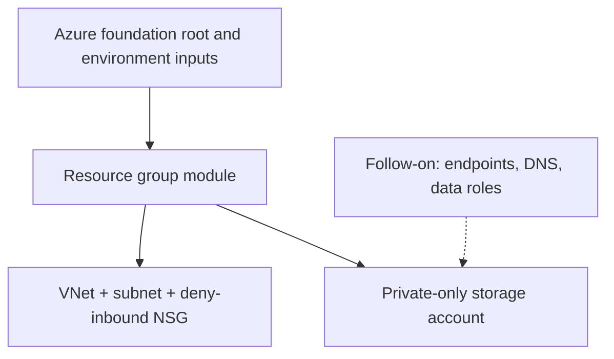

# Project: a modular Azure foundation

**Goal:** connect provider configuration, reusable module interfaces, and
environment naming while keeping live deployment optional.

## Architecture



This is complete foundation configuration, not a running application or a
production landing zone. The private storage account is intentionally
unreachable until you add the required private network and data access.

## Compile the design without Azure

```shell
terraform -chdir=examples/03-azure-foundation init -backend=false
terraform -chdir=examples/03-azure-foundation validate
terraform -chdir=examples/03-azure-foundation test
```

The mocked test verifies composed environment naming and rejects an unknown
environment. The child-module tests protect other contracts.
See the [source view](examples/examples--03-azure-foundation.md).

## Prerequisites for live use

- An approved Azure subscription and permission to create the resources.
- Azure CLI authentication or a scoped approved automation identity.
- Subscription/resource provider registration and regional availability.
- A dedicated state and environment boundary.
- A globally unique storage name, price review, and cleanup plan.

The following uses Bash syntax and values supplied by you:

```bash
az login
az account set --subscription "$SUBSCRIPTION_ID"
az account show --output table
export ARM_SUBSCRIPTION_ID="$(az account show --query id --output tsv)"
terraform -chdir=examples/03-azure-foundation init
terraform -chdir=examples/03-azure-foundation plan \
  -var="storage_account_name=$STORAGE_ACCOUNT_NAME" -out=lab.tfplan
terraform -chdir=examples/03-azure-foundation show lab.tfplan
terraform -chdir=examples/03-azure-foundation apply lab.tfplan
```

`lab.tfplan` is inside that configuration's working directory. Protect it.
For long-lived shared use, configure the [remote backend](state-backends.md)
before creating infrastructure; `-backend=false` does not configure a
production state backend.

## Expected results and checks

The plan should create one resource group, one VNet, a workload subnet,
an NSG and subnet association, and one storage account.
Inspect `terraform output` and Azure's management plane after a live apply.
No public IP, VM, gateway, private endpoint, application, or data role is
part of this foundation.

## Cleanup and next exercise

Use the reviewed destroy workflow in the example README with the same state
and inputs. Confirm actual deletion; never erase state as a shortcut.
Storage usage and future networking components may incur charges.

Next, review the [Azure template library](azure-templates.md). Design
ownership, dependencies, and state separation before adding a service template
that might otherwise duplicate the existing foundation.
