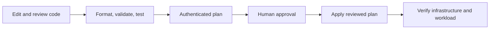

# Plan, review, apply, and destroy

## A safe change sequence



An unreviewed apply is not a substitute for understanding a plan.
Routine CI in this repository stops before real Azure planning or deployment.

## Initialize and validate

Run from the chosen root, not from a parent directory holding unrelated modules:

```shell
terraform init
terraform fmt -check -recursive
terraform validate
terraform test
```

`validate` checks syntax/internal consistency against installed provider schemas.
It does not prove permissions, quota, regional availability, or full policy
compliance. Tests may create real infrastructure in other repositories;
inspect their code before running them.

## Real Azure plan and apply

Only after you have approval, credentials, the intended backend/state, and
your own input values:

```bash
terraform plan -var="storage_account_name=$STORAGE_ACCOUNT_NAME" -out=lab.tfplan
terraform show lab.tfplan
terraform apply lab.tfplan
```

Inspect the resource addresses, create/update/delete/replace actions, region,
names, security settings, and costs. Apply the same approved saved plan rather
than silently creating a new one with changed inputs.
Plans can contain secrets and have a limited valid context; store them with
tight access and short retention, never in a public CI artifact.

## Partial failure

An apply is not a database transaction that rolls back every earlier resource
when a later one fails. Inspect the error and current state, fix the root
cause, and create/review a fresh plan. Do not delete state to make the error
disappear. Provider timeouts may need investigation before retrying.

## Drift

Portal changes can diverge from configuration. Review whether configuration
or the remote change should win. Refresh-only plans are useful for reviewing
recorded state changes, but they do not automatically update desired HCL.
Do not apply a blanket ignore-changes rule just to hide unexplained drift.

## Destroy deliberately

```bash
terraform plan -destroy -var="storage_account_name=$STORAGE_ACCOUNT_NAME" -out=destroy.tfplan
terraform show destroy.tfplan
terraform apply destroy.tfplan
```

Use the same state and input context as creation. Check locks, retention,
soft-delete, unmanaged objects, and shared dependencies. Verify cleanup
actually completed and review lingering costs.
